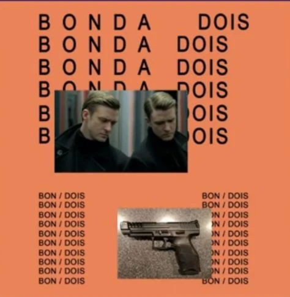
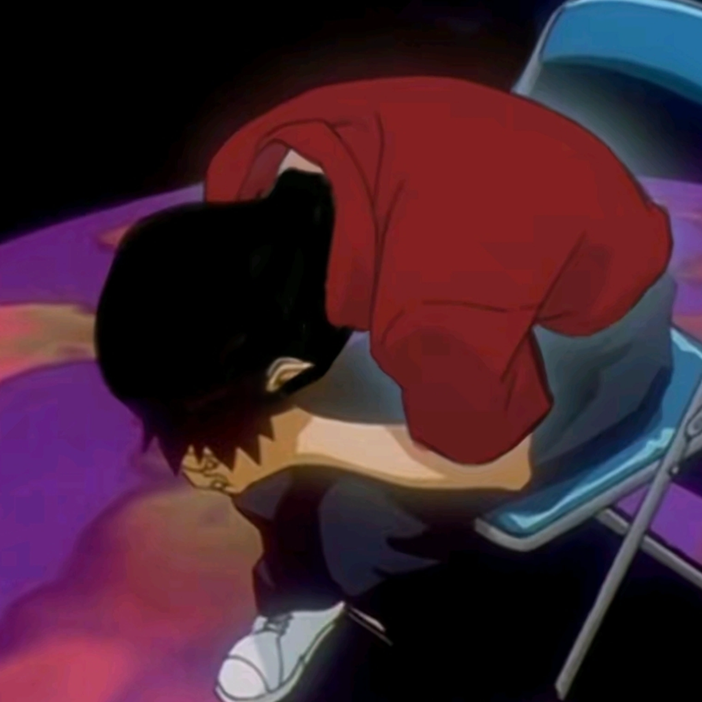
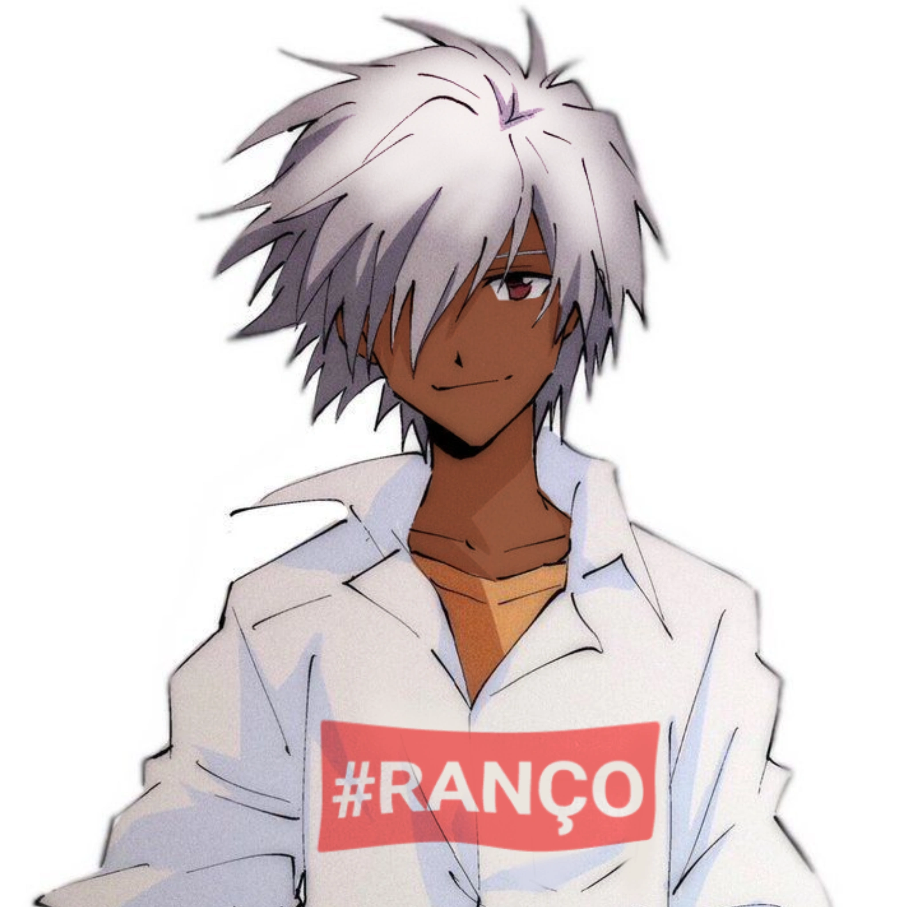
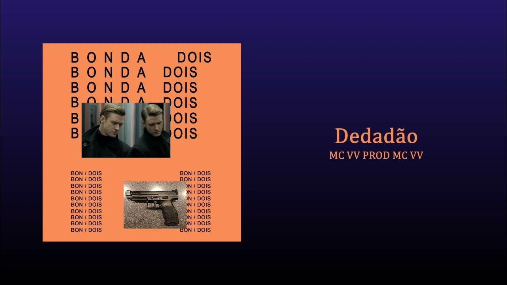
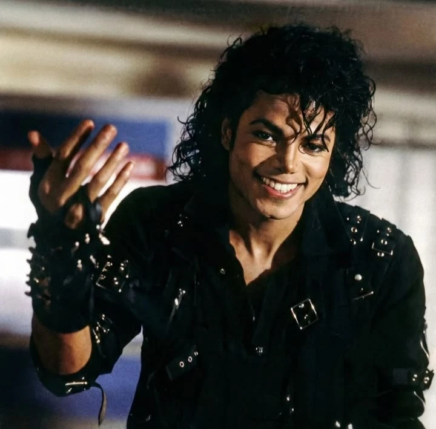
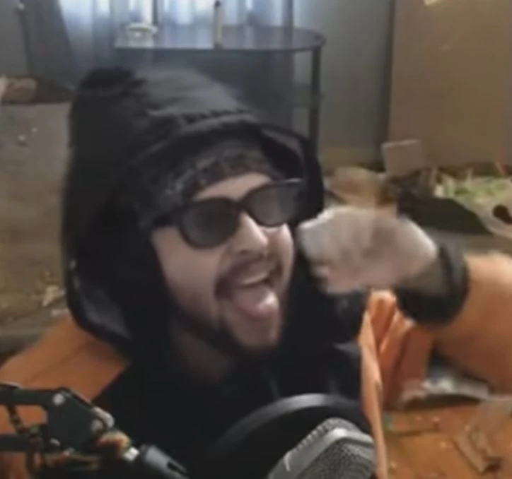
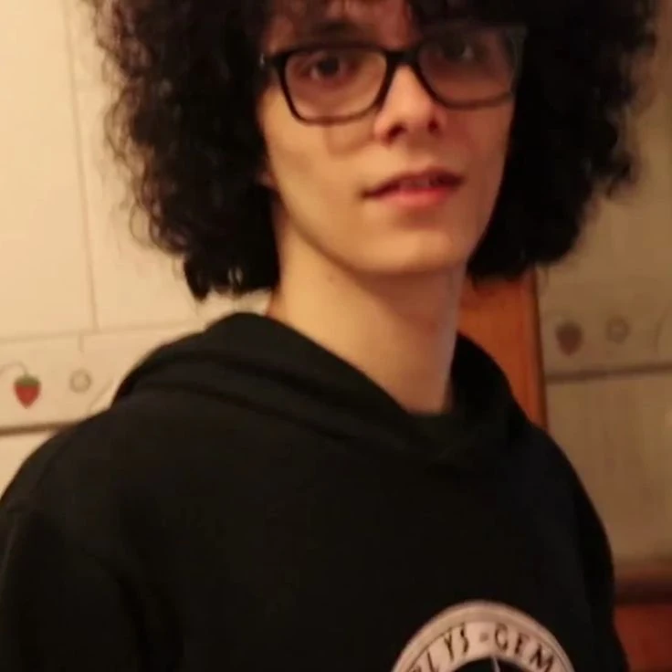
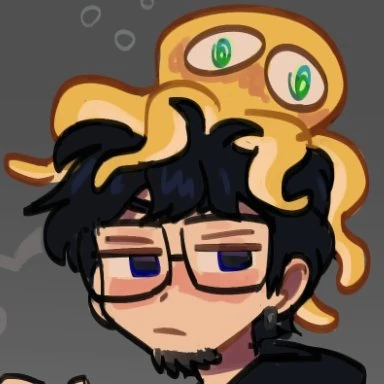

<div align="center">

# 🕹️ BONDAONDA — O Jogo Oficial do Universo BONDA

<p align="center">
  
</p>

[](https://godotengine.org/)
[](#)
[-f1c40f?style=for-the-badge)](#)
[](#)
[](#)

<p align="center">
  <b>Uma experiência retrô 3D em Godot 4.3 ambientada no multiverso satírico dos álbuns conceituais de Yung Lixo / Victor Schiavon (Gemaplys / MC VV), integrando o humor icônico do Flowdaci Podcre, combate cômico, narrativa absurda e desafios de reflexo.</b>
</p>

---

</div>

## 🌌 Sinopse & A Jornada Multiversal

Após uma ruptura catastrófica no tecido do multiverso, as dimensões colapsaram e o protagonista **Junior** foi separado de seu fiel e inseparável companheiro canino, o cão **Robson** (*"Eu te amo, Robson!"*).

Despertando à beira do abismo cósmico conhecido como **The Void**, Junior é abordado por uma entidade transcendental — nada menos que **Michael Jackson** (*"Hee-hee!"*), que o avisa da fúria dos deuses espaciais e concede a ele uma última oportunidade de restaurar a realidade. Atravessando o portal estelar, Junior cai na icônica e perigosa **Dimensão Dedadão**, onde terá que passar por consultas médicas peculiares, sobreviver ao trânsito insano, enfrentar pretendentes ciumentos e desviar da fúria balística de sua ex-namorada.

---

## 👥 Galeria de Personagens

<div align="center">

| Junior | Robson | Dr. Douglas | Michael Jackson |
| :---: | :---: | :---: | :---: |
|  |  |  |  |
| *O Protagonista em busca de redenção* | *O cãozinho mais amado do multiverso* | *O ilustre médico da clínica* | *O guardião do Void Cósmico* |

| Vito (Ricardo Roberto) | Roger Gian (Jean) | Leandro Biffe | Saiko |
| :---: | :---: | :---: | :---: |
|  |  |  |  |
| *Filósofo de rua e produtor musical* | *Gorro clássico e jaqueta alaranjada* | *Mestre das batidas e conselhos* | *Pedestre ilustre do bairro noturno* |

</div>

---

## 🗺️ As Fases do Jogo

```
[The Void (Michael Jackson)] ──> [Portal Estelar] ──> [Quarto Degradado]
                                                             │
[Confronto Estacionamento] <── [Duelo Rival] <── [Clínica Dr. Douglas] <── [Táxi / Rua Noturna]
```

### 1. 🌌 Prólogo: O Vazio Cósmico (*The Void*)
* Inspirado nas faixas *Quebrando Barreiras* e no interlúdio *Me Sinto Feliz* (*BONDA GOOD 4SS JOB*).
* Ilhas flutuantes sobre lagos invertidos, arquitetura surrealista e escadaria suspensa de 80 degraus rumo ao portal celeste.
* Encontro narrativo com **Michael Jackson**, alertando sobre o colapso do multiverso com bordão sonoro clássico (*michael_hee.mp3*).
* Shader customizado analógico de **Fita VHS Retrô** ativável e desativável em tempo real (`V`).

### 2. 🏠 O Apartamento Degradado (Pós-Portal)
* Ponto de aterrissagem na Terra: quarto caótico com TV de tubo em mesa vermelha de bar, colchão manchado, latas espalhadas, louça acumulada e recado na parede: *"Consulta hoje às 16:00"*.
* **17 interações ambientais:** tarefas opcionais de faxina e organização.
* **Conquista secreta:** Desbloqueio de *"Caja susa, chão sujo..."* ao higienizar o cômodo por completo.

### 3. 🏙️ O Bairro Noturno & Pedestres
* Bairro urbano estilizado em 320x180 com névoa volumétrica gradual e iluminação noturna retrô.
* **9 NPCs icônicos com 36 falas rotativas exclusivas:**
  * **Jean** (Roger Gian), **Vito** (Ricardo Roberto), **Biffe** (Leandro Bife), **Saiko**, **Tiba**, **Scottonauta**, **Hawk**, **Raposito** e **Umild**.
* **Trânsito Contínuo & Fatal:** Sistema de 12 veículos em loop contínuo com detecção física de colisão e atropelamento letal instantâneo.
* **Tarefas de Preparação ("As Novas Idas ao Douglas"):**
  * 📄 **A Ficha Voou:** Coleta de 3 folhas da ficha médica arrastadas pelo vento ao longo da calçada.
  * ☕ **Café para Dois:** Transporte cuidadoso de café da banca até a clínica (correr ou pular faz derramar).
  * 🌳 **Fora do Horário:** Passeio a pé ao lado de Dr. Douglas até o banco da praça com escolhas de diálogo íntimas.

### 4. 🚖 A Corrida de Táxi & O Sequestro
* Viagem interativa no banco de passageiro do táxi com diálogo inquisitivo do motorista.
* **Atenção Máxima:** Revelar informações pessoais privadas resulta em sequestro sumário e *Game Over* imediato!

### 5. 🩺 O Consultório do Dr. Douglas
* Consulta clínica hilária, cutscenes progressivas de retorno constante e minigame de persuasão romântica com escolhas de diálogo para convidar Douglas para sair.

### 6. 🥊 O Encontro e o Duelo Ciumento
* Encontro romântico interrompido por um paciente rival ciumento.
* Combate 3D em tempo real com mecânicas de socos, bloqueio com guarda, esquivas ágeis e barras de estamina.

### 7. 💔 O Confronto no Estacionamento (Bullet-Hell da Ex)
* A ex-namorada enfurecida flagra o casal de mãos dadas e ataca arremessando rajadas de projéteis.
* Minigame de sobrevivência frenético de 30 segundos com 3 vidas e dificuldade progressiva com leques de projéteis a cada 7,5 segundos.

---

## 🎮 Controles

| Tecla / Comando | Ação |
| :---: | :--- |
| `W`, `A`, `S`, `D` | Movimentação do personagem |
| `Mouse` | Rotação e controle orbital da câmera |
| `Espaço` | Pular |
| `Shift` | Correr *(Cuidado: derrama o café em 'Café para Dois')* |
| `E` | Interagir / Conversar / Limpar lixo / Coletar itens |
| `V` | Alternar filtro de fita VHS (na dimensão The Void) |
| `Esc` | Menu de pausa, novidades e conquistas |

---

## 🎵 Trilha Sonora Canônica Integrada

Todas as faixas musicais foram compostas por **Yung Lixo / Gemaplys** e integradas diretamente no áudio do jogo:
1. 🎶 **Dedadão** — *Tema principal da exploração urbana e tensão médica*
2. 🎶 **Condomínio Life** — *Ambientação do bairro e cotidiano dos pedestres*
3. 🎶 **Douglas & Eu** — *Momentos românticos e intimistas com o Dr. Douglas*
4. 🎶 **Douglas & Ele** — *Conflito e ciúmes com o paciente rival*
5. 🎶 **Não Erro Tiro de Nine** — *Clímax do combate e esquiva dos projéteis da ex*
6. 🎙️ **Efeitos Vocais Especiais** — *Bordão icônico de Michael Jackson (michael_hee.mp3)*

---

## 🛠️ Tecnologias e Arquitetura

* **Engine:** [Godot Engine 4.3 Standard](https://godotengine.org/)
* **Linguagem:** GDScript nativo
* **Modelagem 3D:** Modelos Low-Poly procedurais gerados em Python/GLTF
* **Pipeline Gráfico Retrô & Shaders GLSL:**
  * `street_fog.gdshader`: Neblina volumétrica com atenuação proporcional por profundidade.
  * `street_pixels.gdshader`: Renderização interna em 320x180 com paleta de 15 bits estilo PlayStation 1.
  * `void_tape.gdshader`: Distorções de rastreamento de fita magnética VHS.
  * `void_current.gdshader` & `void_water.gdshader`: Simulação de fluidos e correntes cósmicas interdimensionais.
* **Labels Nativos:** Sistema de renderização de nomes de NPCs em alta resolução sobrepostos ao shader retrô com teste de oclusão (`street_labels.gd`).

---

## 📋 Histórico Completo de Versões

* **v0.1 — Dimensão Dedadão:** Protótipo inicial jogável com as 4 subfases fundamentais, minigame de táxi, consultório, luta 3D e bullet-hell da ex.
* **v0.2 — Bairro e Visitas:** Adição dos 9 NPCs com 36 falas rotativas, trânsito letal contínuo e as tarefas da ficha, café e passeio com Douglas.
* **v0.3 — The Void & VHS:** Prólogo cósmico do Vazio com Michael Jackson, escadaria de 80 degraus e filtro de fita VHS.
* **v0.4 — Quarto & Conquistas:** Apartamento degradado com 17 pontos de interação, conquista *"Caja susa, chão sujo..."* e tela de conquistas.
* **v0.5 — Void-Portal-Casa:** Transição fluida direta do Void para o quarto e diálogos de chegada.
* **v0.6 — Bairro Noturno:** Rua ampliada para 360m, neblina volumétrica e física dinâmica de suspensão de carros.
* **v0.7 — Versão de Ouro:** Rua compactada em 104m, labels nativos de alta legibilidade com oclusão e circuito de tráfego contínuo com 12 veículos e frenagem inteligente.

---

## 🚀 Como Executar o Jogo

1. Baixe e instale a **Godot Engine 4.3 Standard** em [godotengine.org](https://godotengine.org/download/).
2. Clone o repositório:
   ```bash
   git clone https://github.com/theSenf3i/BONDA-PROJECT.git
   ```
3. Abra a Godot e clique no botão **Importar** (*Import*).
4. Navegue até a pasta clonada e selecione o arquivo `project.godot`.
5. Clique em **Editar** (*Edit*) ou pressione **`F5`** para jogar imediatamente!

---

## 📜 Créditos e Inspirações

* **Universo BONDA & Composições:** Victor Schiavon (Gemaplys / Yung Lixo / MC VV)
* **Elenco de Vozes e Comédia:** Flowdaci Podcre (Roger Gian, Ricardo Roberto, Gleison) e comunidade
* **Desenvolvimento e Direção de Projeto:** [Arthur Pereira (@theSenf3i)](https://github.com/theSenf3i)
